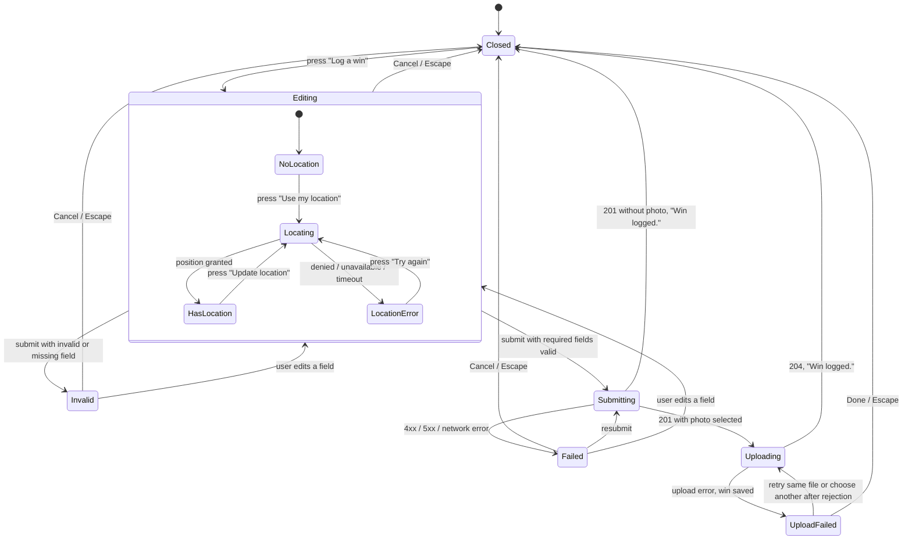

# Create win

## Why

Let users log a win with a reflection, a category, where it happened, and an
optional photo. A failed upload still leaves the reflection saved.

## Where it lives

- `apps/web/app/api/wins/route.ts` — HTTP handler (`POST`).
- `packages/domain/src/index.ts` — `CreateWin` validation and the user-scoped `createWin` query.
- `packages/domain/tests/win-schema.test.ts` — schema contract tests.
- `apps/web/components/LogWinDialog.tsx` — form, geolocation, photo preview, and retry.
- `apps/web/components/logWinValidation.ts` — pure, client-safe validation and error-message mapping used by the dialog.
- `tests/web/log-win-validation.test.ts` — tests for the pure module.
- `apps/web/app/sandbox/log-win/page.tsx` — temporary demo page until a real page imports the dialog.
- `apps/web/app/api/wins/[id]/photo/route.ts` — attaches and serves the photo.
- `packages/domain/` — upload validation and user-scoped photo queries.
- `packages/db/prisma/` — nullable blob key on the win.
- `packages/services/src/storage.ts` — stores and reads image bytes.

## Behavior

`POST /api/wins` validates the JSON body, creates a win owned by the current user, and returns `{ win }` with status 201.
The client may only send `reflection`, `category`, `latitude`, `longitude`, and an optional `photoUrl`. `id`, `userId`, and timestamps are set by the server.
Errors use `{ error: { code, message } }`.
Authenticated writes require a matching Origin header; rejected origins get
403 `BAD_ORIGIN`. Auth storage/configuration unavailability gets 503
`AUTH_UNAVAILABLE`; other unexpected database failures retain the shared 500.

## Endpoint

| Path | Method | Input schema | Error codes | Scoped by |
|---|---|---|---|---|
| `/api/wins` | POST | `CreateWin`: `reflection` (1–500 chars, trimmed), `category` (`FITNESS`, `ACADEMIC`, `CAREER`, `PERSONAL`), `latitude` (number), `longitude` (number), `photoUrl` (optional URL) | 400 `BAD_JSON`, 400 `VALIDATION`, 401 `UNAUTHENTICATED`, 500 `INTERNAL_ERROR` | `userId` from `currentUserId()` |

### Photo endpoints

`PUT /api/wins/:id/photo` accepts `multipart/form-data` with one `photo` file.
The server accepts JPEG, PNG, or WebP signatures up to 5 MiB, uploads the bytes,
saves the blob key on the win, and returns `204`. If the attachment already
committed and the response was lost, a retry returns `204` with the photo intact.

`GET /api/wins/:id/photo` serves the stored image to the owner. Win reads expose
this route as `photoUrl` for a managed photo and retain the existing `photoUrl`
value for wins without a managed photo.

Both routes require a session and return `404` for unknown or foreign wins.
A photo read returns `404` when the attachment or its blob is missing. Uploads
require a matching Origin. Errors use the shared envelope, including `400` for
invalid files, `401` for missing sessions, `403` for a rejected Origin, `503` when
storage is unavailable, and `500` for unexpected failures.

## Examples

| Request or condition | Result |
|---|---|
| Valid body | 201, `{ win }` owned by the current user |
| Body is not valid JSON | 400, `BAD_JSON` |
| Missing or invalid field (for example `{}`) | 400, `VALIDATION` |
| No resolved user ID | 401, `UNAUTHENTICATED` |
| Database failure (including a user that does not exist) | 500, `INTERNAL_ERROR`; details logged on the server |
| Another signed-in user reads or uploads a photo for the win | The photo route returns `404` |
| Photo upload is retried after its first response is lost | 204, the existing photo is intact |

## Verify

Run `pnpm test` and `pnpm test:integration`. With the local app running, sign
in, send a valid POST, a `{}` body, and a non-JSON body using its session
cookie, and confirm another signed-in user's cookie does not reveal the new
win. Include the matching Origin header for CLI writes. Without a valid
cookie, all of those requests return structured 401.

For the form, see [Log a win dialog](#log-a-win-dialog).
Photo endpoint tests cover ownership, the 5 MiB boundary, unsupported images,
and retry after an attachment commits.

## Constraints & decisions

The [auth subsystem](../auth.md) supplies a verified session user. New wins
belong to that user; no demo-user fallback or client-supplied identity exists.

Form decisions:

- Location is acquired only on an explicit button press: an unprompted permission dialog on page load is hostile, and it makes the `LocationError` state reachable only by user action.
- Latitude and longitude are required because `CreateWin` requires them; the form does not invent a default location.
- Client validation exists for fast feedback only. The server's `CreateWin` result is authoritative, and a server `VALIDATION` error is shown rather than hidden.
- The form uses the native `<dialog>` + `showModal()` pattern from [Delete win](delete.md) and opens over the page hosting it.
- Closing the dialog (Cancel or Escape) discards the draft; a half-written reflection is not kept between openings.
- Client validation mirrors `CreateWin`'s limits in a separate pure module rather than importing it: `@project/domain` imports the Prisma client and must not enter the browser bundle. The server stays authoritative.
- There are no component tests and no DOM test dependency: the repo's other components are verified by manual drills, and Vitest runs in the `node` environment. Logic that can fail lives in the pure module so it is tested.
- The dialog is a Client Component because it needs state and browser geolocation.
- No new runtime dependencies: plain controlled inputs and `fetch`, no form library.
- When a photo is selected, one **Save** action uses two requests so a storage
  outage cannot block saving a reflection. Stopping Azurite is only for the
  local outage drill.
- The selected file stays in memory while the dialog is open. Closing the dialog
  or reloading the page ends the retry session.
- Azure Blob Storage holds the bytes and Postgres holds the blob key. A database
  failure after a blob upload can leave an unlinked blob. The photo route serves
  the blob referenced by the current user's win. See [storage](../storage.md)
  and the [blob storage ADR](../../adr/0006-blob-storage.md).

## Log a win dialog

`LogWinDialog` renders a **Log a win** button. Pressing it opens a modal dialog (native `<dialog>`, `showModal()`) that holds the form for `POST /api/wins`. The dialog is named by its heading (`aria-labelledby`), focus moves to the Reflection field on open, Tab cycles inside it only, and Escape or **Cancel** closes it and returns focus to the trigger.

The form requires **Reflection** (textarea, 1–500 characters after trimming), **Category** (select: Fitness, Academic, Career, Personal), and **Location** (set by a "Use my location" button that calls `navigator.geolocation.getCurrentPosition`). Location is never requested until the user presses that button. Once set, the button is replaced by a "Location added" card with an "Update location" action. The optional **Photo** picker accepts one image and shows a preview.

The reflection character counter sits below the textarea, aligned right, so it never overlaps entered text.

Submit is blocked until reflection, category, and location are all valid. Reflection and category errors appear only on submit. Errors are linked to their field with `aria-describedby`, and the first invalid field receives focus on a blocked submit.

**Save** sends `{ reflection, category, latitude, longitude }` as JSON. After
`201`, the dialog uses the returned win ID to upload the selected file, if any.
During the initial save and photo upload, the dialog keeps the form in view,
disables its inputs and actions, prevents dismissal, and shows “Saving…” or
“Uploading photo…” on the Save button.
Both successful paths close the dialog, clear the draft, return focus to the
trigger, and announce “Win logged.” in a `role="status"` region outside the
dialog. The [timeline](timeline.md) shows the photo when it loads the win.

If creation fails, the dialog keeps the entered values, file, and preview,
shows the error in a `role="alert"` region, and re-enables the form. If only
the upload fails, the alert says “Your win was saved, but the photo couldn’t
upload.” **Retry photo** sends the same file to the saved win without reopening
the picker or camera. If the server rejects the size or format, the dialog
explains the rejection and offers **Choose another photo** for the saved win.
**Done** closes the dialog and clears the local file. The dialog switches to
the photo recovery view only after an upload fails. That view stays in place
while a retry runs.

| State / input | Behavior |
|---|---|
| Press "Log a win" | Dialog opens; focus on Reflection; background is inert |
| Valid reflection, category, location; save without a photo or with a successful upload | Dialog closes, announces “Win logged.”, returns focus to trigger, and clears the draft |
| Escape or Cancel while editing | Dialog closes; focus on trigger; draft discarded |
| Escape while `Submitting` or `Uploading` | Dialog stays open |
| Initial photo upload is in flight | The form stays visible and “Uploading photo…” appears on Save |
| Reflection empty or whitespace only; submit | `Invalid`; "Add a reflection" shown; focus on reflection; no request sent |
| Reflection is exactly 500 characters | Accepted |
| Reflection is 501 characters | `Invalid`; "Keep it to 500 characters" |
| Submit before pressing "Use my location" | `Invalid`; "Add your location" shown; no request sent |
| Geolocation permission denied | `LocationError`; message says location is required and offers "Try again"; reflection and category are untouched |
| Server returns 400 `VALIDATION` | `Failed`; server message shown in `role="alert"`; dialog open; values kept |
| Server returns 401 `UNAUTHENTICATED` | `Failed`; "Please sign in to log a win."; values kept |
| Network error or 500 | `Failed`; generic "Couldn't save your win. Please try again."; values kept; resubmit allowed |
| Double-click Save | Exactly one create request. If creation succeeds and a photo is selected, exactly one upload follows. |
| Photo upload fails after creation | File and preview stay visible. Retry uploads only to the saved win. Done keeps the win. |
| Server rejects photo size or format | The dialog explains the rejection and offers another photo for the saved win. |

Verify: run `pnpm exec vitest run tests/web/log-win-validation.test.ts`, which covers the validation rows (empty, whitespace, 500, 501, missing category, missing location) and the status-to-message mapping (400 shows the server message, 401, 500, network failure). The dialog, focus, and failure-keeps-values rows are verified by this drill, at `/sandbox/log-win` with `pnpm dev` running:

1. Keyboard only: Enter on "Log a win", then use Tab and Shift+Tab to reach
   the photo picker, reflection, category, location, Cancel, and Save. Confirm
   focus stays inside the dialog, Escape closes it, and focus returns to the trigger.
2. Submit an empty form and confirm focus lands on the first invalid field and its error is announced.
3. Deny the browser location permission and confirm the `LocationError` path and "Try again".
4. Stop the database, submit a valid form, and confirm `Failed` keeps the dialog open and the values and shows the generic message with no raw error text.
5. Sign in, save with a valid photo and again without one. Throttle the network
   to confirm the form stays visible during the upload. Confirm the same close,
   focus return, and announcement both times. Load the timeline and confirm
   the attached photo appears.
6. For the local outage drill, stop only Azurite and leave the web app and
   Postgres running. Save with a valid photo and confirm the win exists and the
   preview stays visible. Restart Azurite and press **Retry photo** without
   selecting or taking another photo. Confirm only the upload request is sent
   and the timeline shows exactly one win with its photo. Repeat the failure
   and press **Done** to confirm the win stays saved without a photo.

## Out of scope

The edit flow overwrites the edited values on the existing win. A newly
selected photo replaces the current photo. See [Delete win](delete.md) and
[Timeline](timeline.md) for those flows. Resuming an upload after dismissal,
background retries, thumbnails, orphaned blob cleanup, reverse-geocoding, and
session authentication are out of scope.
