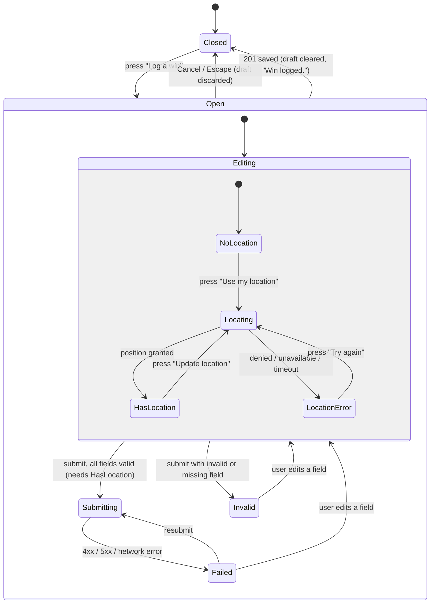

# Create win

## Why

Let users log a win with a reflection, a category, and where it happened.

## Where it lives

- `apps/web/app/api/wins/route.ts` — HTTP handler (`POST`).
- `packages/domain/src/index.ts` — `CreateWin` validation and the user-scoped `createWin` query.
- `packages/domain/tests/win-schema.test.ts` — schema contract tests.
- `apps/web/components/LogWinDialog.tsx` — Client Component: trigger button, modal dialog, form state, geolocation, submit.
- `apps/web/components/logWinValidation.ts` — pure, client-safe validation and error-message mapping used by the dialog.
- `tests/web/log-win-validation.test.ts` — tests for the pure module.
- `apps/web/app/sandbox/log-win/page.tsx` — temporary demo page until a real page imports the dialog.

## Behavior

`POST /api/wins` validates the JSON body, creates a win owned by the current user, and returns `{ win }` with status 201.
The client may only send `reflection`, `category`, `latitude`, `longitude`, and an optional `photoUrl`. `id`, `userId`, and timestamps are set by the server.
Errors use `{ error: { code, message } }`.

## Endpoint

| Path | Method | Input schema | Error codes | Scoped by |
|---|---|---|---|---|
| `/api/wins` | POST | `CreateWin`: `reflection` (1–500 chars, trimmed), `category` (`FITNESS`, `ACADEMIC`, `CAREER`, `PERSONAL`), `latitude` (number), `longitude` (number), `photoUrl` (optional URL) | 400 `BAD_JSON`, 400 `VALIDATION`, 401 `UNAUTHENTICATED`, 500 `INTERNAL_ERROR` | `userId` from `currentUserId()` |

## Examples

| Request or condition | Result |
|---|---|
| Valid body | 201, `{ win }` owned by the current user |
| Body is not valid JSON | 400, `BAD_JSON` |
| Missing or invalid field (for example `{}`) | 400, `VALIDATION` |
| No resolved user ID | 401, `UNAUTHENTICATED` |
| Database failure (including a user that does not exist) | 500, `INTERNAL_ERROR`; details logged on the server |

## Verify

Run `pnpm test`. Then, with `pnpm dev` running, send a valid POST, a `{}` body, and a non-JSON body, and confirm a GET as a different `x-user-id` does not show the new win. For the form, see [Log a win dialog](#log-a-win-dialog).

## Constraints & decisions

The [dev auth stub](../auth.md) defaults to the demo user when no identity is supplied, and that user must exist in the `User` table for a create to succeed.

Form decisions:

- Location is acquired only on an explicit button press: an unprompted permission dialog on page load is hostile, and it makes the `LocationError` state reachable only by user action.
- Latitude and longitude are required because `CreateWin` requires them; the form does not invent a default location.
- Client validation exists for fast feedback only. The server's `CreateWin` result is authoritative, and a server `VALIDATION` error is shown rather than hidden.
- The form is a modal pop-up, not a page: it opens over whatever page hosts it and does not fill the screen. It follows the native `<dialog>` + `showModal()` pattern of `DeleteWinDialog` (see [delete.md](delete.md)), so it needs no route of its own and no new endpoint.
- Closing the dialog (Cancel or Escape) discards the draft; a half-written reflection is not kept between openings.
- Client validation mirrors `CreateWin`'s limits in a separate pure module rather than importing it: `@project/domain` imports the Prisma client and must not enter the browser bundle. The server stays authoritative.
- There are no component tests and no DOM test dependency: the repo's other components are verified by manual drills, and Vitest runs in the `node` environment. Logic that can fail lives in the pure module so it is tested.
- The dialog is a Client Component because it needs state and browser geolocation.
- No new runtime dependencies: plain controlled inputs and `fetch`, no form library.

## Log a win dialog

`LogWinDialog` renders a **Log a win** button. Pressing it opens a modal dialog (native `<dialog>`, `showModal()`) that holds the form for `POST /api/wins`. The dialog is named by its heading (`aria-labelledby`), focus moves to the Reflection field on open, Tab cycles inside it only, and Escape or **Cancel** closes it and returns focus to the trigger.

The form has three inputs: **Reflection** (textarea, 1–500 characters after trimming), **Category** (select: Fitness, Academic, Career, Personal), and **Location** (set by a "Use my location" button that calls `navigator.geolocation.getCurrentPosition`). Location is never requested until the user presses that button. Once set, the button is replaced by a "Location added" card with an "Update location" action.

Submit is blocked until reflection, category, and location are all valid. Reflection and category errors appear only on submit. Errors are linked to their field with `aria-describedby`, and the first invalid field receives focus on a blocked submit.

On submit the form sends `{ reflection, category, latitude, longitude }`. While the request is in flight every input, Cancel, and the submit button are disabled, the button reads "Saving…", and Escape does not close the dialog. Success closes the dialog, clears the draft, returns focus to the trigger, and announces "Win logged." in a `role="status"` region that sits outside the dialog. A failure keeps the dialog open and every entered value, shows the server's `error.message` (or a generic message for network failure) in a `role="alert"` region, and re-enables the form. The form never sends `userId`, `id`, or timestamps.

`Invalid` and `Failed` keep all entered values. `Submitting` is the only state in which inputs are disabled, a second submit cannot start from it, and it cannot be left by closing the dialog.

| State / input | Behavior |
|---|---|
| Press "Log a win" | Dialog opens; focus on Reflection; background is inert |
| Valid reflection, category, location; submit | `Submitting`, then dialog closes; "Win logged."; focus on trigger; draft cleared |
| Escape or Cancel while editing | Dialog closes; focus on trigger; draft discarded |
| Escape while `Submitting` | Dialog stays open |
| Reflection empty or whitespace only; submit | `Invalid`; "Add a reflection" shown; focus on reflection; no request sent |
| Reflection is exactly 500 characters | Accepted |
| Reflection is 501 characters | `Invalid`; "Keep it to 500 characters" |
| Submit before pressing "Use my location" | `Invalid`; "Add your location" shown; no request sent |
| Geolocation permission denied | `LocationError`; message says location is required and offers "Try again"; reflection and category are untouched |
| Server returns 400 `VALIDATION` | `Failed`; server message shown in `role="alert"`; dialog open; values kept |
| Server returns 401 `UNAUTHENTICATED` | `Failed`; "Please sign in to log a win."; values kept |
| Network error or 500 | `Failed`; generic "Couldn't save your win. Please try again."; values kept; resubmit allowed |
| Double-click on submit | Exactly one request is sent |

Verify: run `pnpm exec vitest run tests/web/log-win-validation.test.ts`, which covers the validation rows (empty, whitespace, 500, 501, missing category, missing location) and the status-to-message mapping (400 shows the server message, 401, 500, network failure). The dialog, focus, and failure-keeps-values rows are verified by this drill, at `/sandbox/log-win` with `pnpm dev` running:

1. Keyboard only: Enter on "Log a win", Tab through reflection → category → location button → Cancel → submit; confirm focus stays inside the dialog, Escape closes it, and focus returns to the trigger.
2. Submit an empty form and confirm focus lands on the first invalid field and its error is announced.
3. Deny the browser location permission and confirm the `LocationError` path and "Try again".
4. Stop the database, submit a valid form, and confirm `Failed` keeps the dialog open and the values and shows the generic message with no raw error text.
5. Submit a valid form and confirm the win appears in `GET /api/wins` for `demo-user`.

## Out of scope

Photo upload and `photoUrl` in the form (a separate endpoint), editing, deleting ([delete.md](delete.md)), showing the new win in a timeline ([list.md](list.md)), reverse-geocoding coordinates to a place name, and session authentication.